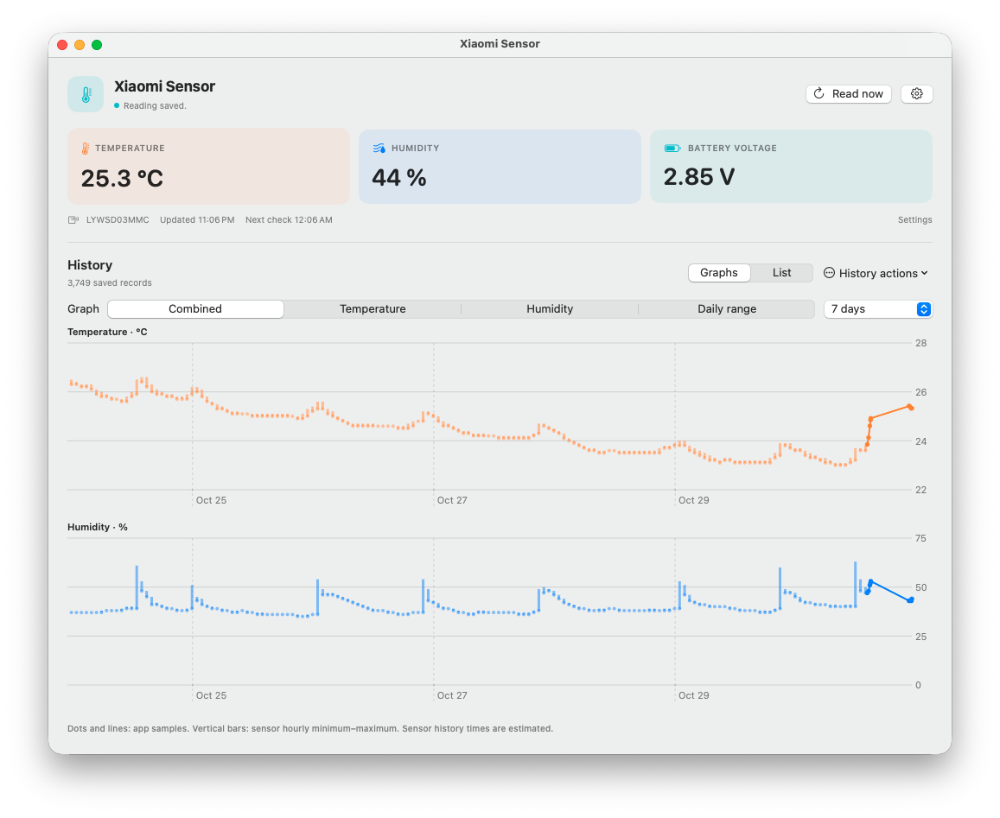
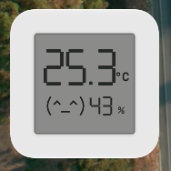

# Xiaomi Sensor for macOS

A native Bluetooth monitor for Xiaomi LYWSD03MMC, with a macOS desktop widget. The app connects only for scheduled readings (one hour by default) and then disconnects. Requires macOS 14 Sonoma or newer. The app supports Apple silicon and Intel.

## Screenshots

### Dashboard and history graphs

### Desktop widget

## Installation

Download the DMG from [Releases](../../releases), open it and drag Xiaomi Sensor into Applications. Open the app and grant Bluetooth access, then select your nearby sensor. To add the widget, right-click the desktop, choose **Edit Widgets**, search for **Xiaomi Sensor** and add it. Closing the app window keeps the app running in the menu bar for scheduled readings. Use the thermometer icon to reopen the window or quit. If you quit the app completely, readings stop. Checks due during sleep resume after the Mac wakes. Choose the interval in the main window; use Read now for a manual sample. Use Import sensor history to download stored hourly minimum/maximum readings, then Export CSV to save them. Import can take several minutes. Historic timestamps are estimated from sensor uptime; a reset or firmware differences can affect dates and availability. The app does not wake a sleeping Mac.

The widget displays the last recorded reading and its age. WidgetKit controls refreshes, so the widget is not continuously live. Desktop widget registration and Bluetooth connection have not been verified on physical hardware. The ad-hoc signed build is not notarized; macOS may require **System Settings → Privacy & Security → Open Anyway**. The widget reads a local snapshot shared by the app. If the widget does not appear, ensure the app is installed in Applications and launched once. Ad-hoc signing can prevent widget discovery on some macOS versions; this build has not been tested in the widget gallery on a physical Mac.

## Compatibility

Targets the original Xiaomi firmware's EBE0CCC1 measurement notifications. It does not decrypt Xiaomi advertisements or support Zigbee and custom firmware formats. Some hardware or firmware versions may require pairing or lack the characteristic. Disconnect other clients if they hold the Bluetooth connection.

Protocol references: [MiTemperature2](https://github.com/JsBergbau/MiTemperature2/blob/master/LYWSD03MMC.py), [lywsd03mmc-client](https://github.com/keks51/lywsd03mmc-client).

## Build

On a Mac with Xcode command line tools, run `bash scripts/build.sh`. The DMG is created at `build/Xiaomi-Sensor.dmg`. The app and extension are ad-hoc signed and not notarized.
